<div align="center">


# benchboss

**Run your ESPN Fantasy Basketball team from the terminal.**

Live matchup dashboard · one-key lineup optimizer · waiver scout that does the math · player finder · playoff odds · trade finder · player news

[](https://github.com/ValeQRamos/benchboss/actions/workflows/ci.yml)


[](LICENSE)


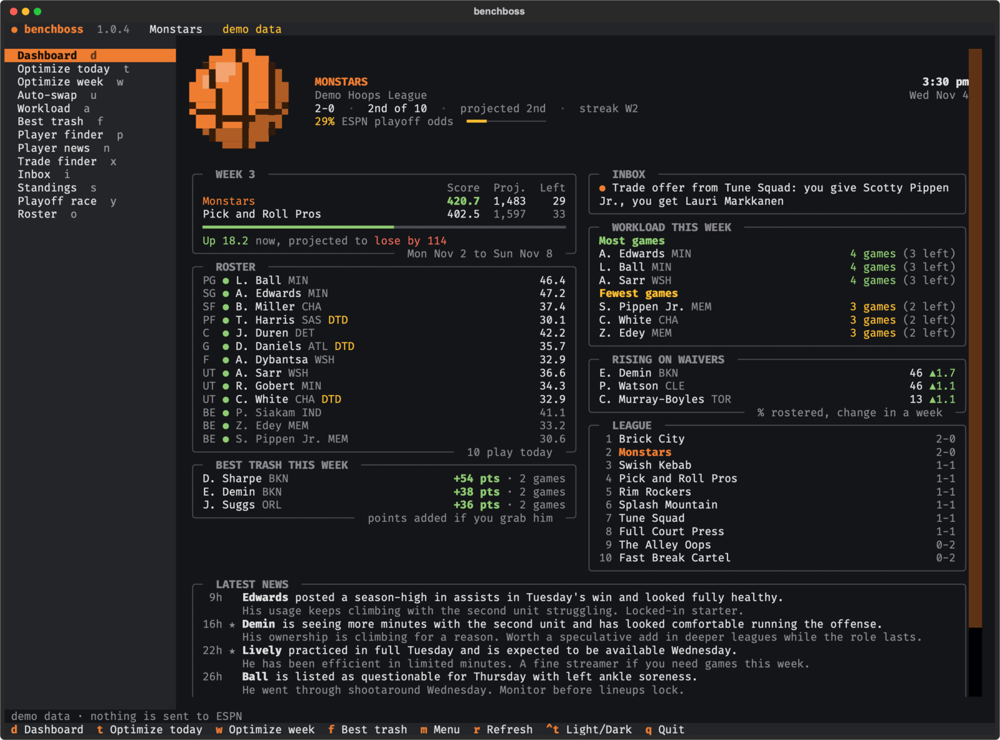

</div>

---

benchboss is a fast, keyboard-driven companion for **ESPN head-to-head points leagues** with
daily lineups. It reads your league with the same cookies your browser uses, shows everything
that matters this week on one screen, and turns the chores that decide close matchups into a
single key: set the best lineup for today or the whole week, find the free agent who adds the
most points before Sunday, and spot fair trades that fix a positional hole on both sides. It
also finds players by recent form, keeps your ESPN watch list, and plays out the rest of the
season to show your playoff odds.

Try it in ten seconds, no ESPN account needed (with [uv](https://docs.astral.sh/uv/) installed):

```bash
uvx --from "benchboss @ https://github.com/ValeQRamos/benchboss/archive/refs/heads/main.zip" benchboss --demo
```

## Contents

- [Features](#features)
- [Install](#install)
- [Quick start](#quick-start)
- [Using it from VS Code](#using-it-from-vs-code)
- [Commands](#commands)
- [How the numbers work](#how-the-numbers-work)
- [Configuration](#configuration)
- [Privacy and safety](#privacy-and-safety)
- [FAQ](#faq)
- [Roadmap](#roadmap)
- [Contributing](#contributing)
- [Contact](#contact)

## Features

| Feature | What it does |
|---|---|
| **Matchup dashboard** | Live score, a projected final for both sides, games left this week, your roster with who plays today, your place and ESPN's playoff odds, standings, alerts and the latest news. Works full screen or as a narrow side panel that refreshes itself. |
| **Optimize today / Optimize week** | One key sets the best lineup for today or for every day left in the matchup week. Benches players who rest, are OUT or project less; doubtful and day-to-day players are discounted. Each day shows the moves, the lineup they leave and why everyone on the bench sits, with the injury math written out. Waits for **Apply**, then tells you *"Your week is set"*. |
| **Workload this week** | Games per player this week with the opponent each day, his position and today's slot. Reads the lineup ESPN has saved for every day, so the games a player spends on your bench are marked, and the footer shows the days you have more games than starting spots. In daily leagues, volume wins. |
| **Best trash** | Ranks free agents ("trash") by the points they would actually add to *your* lineup from the day you grab them to Sunday, after subtracting what your weakest player would have scored. A strip shows the days each one plays. Knows about waivers. |
| **Player finder** | Free agents, players on a team, your watch list or everyone, in one table: fantasy points per game for the season, the last 7, 15 and 30 days, ESPN's projection and last season, plus the box score. Sort by any column, filter by position, search by name, and star players on your ESPN watch list. |
| **Playoff race** | Playoff, seed and division odds from 5,000 simulated seasons, seeded the way ESPN does it. Pick winners for the games left and watch the odds move. |
| **Roster and standings** | Your roster with every stat split side by side and the box score of one. Standings with PF, PA, Diff, streaks, games back, ESPN's playoff odds, clinch tags and the playoff line, plus a table per division and one with the waiver order and every team's adds, drops and trades. |
| **Trade finder** | Profiles every roster by position, finds where you are deep and they are thin (and the other way around), and proposes fair 1-for-1 deals that respect league position limits. Comes with a ready-to-send note. |
| **Player news** | The latest RotoWire blurbs and their "spin" for your players and your watch list, plus an optional AI briefing that searches the web. The app pops up a note when a watch-list player gets news. |
| **Inbox** | Trade offers sent to you, accepted trades waiting to process, pending claims, unread DMs and watch-list news you have not seen. |
| **Agent ready** | Every read command speaks `--json`; every write has `--dry-run`. The repo ships instructions and skills so GitHub Copilot, Claude Code and other agents can drive it safely. |

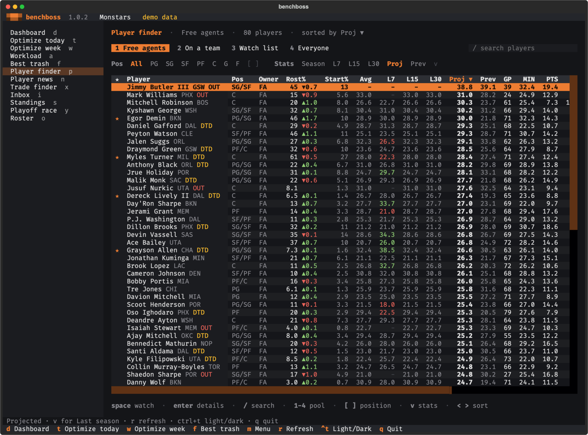<br>
<sub><b>Player finder</b>: every split side by side, the box score of the one you pick, and a star for your ESPN watch list.</sub>

<table>
<tr>
<td width="50%">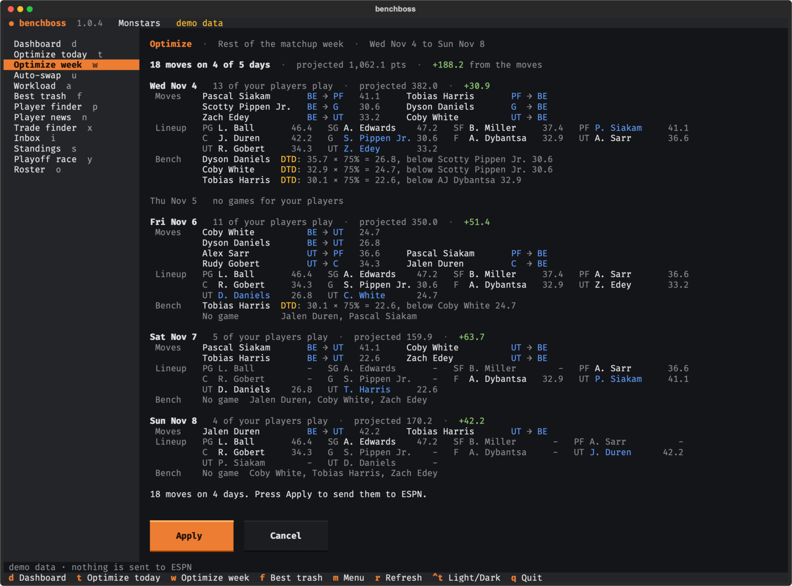<br><sub><b>Optimize week</b>: the moves for every day, applied with one key.</sub></td>
<td width="50%">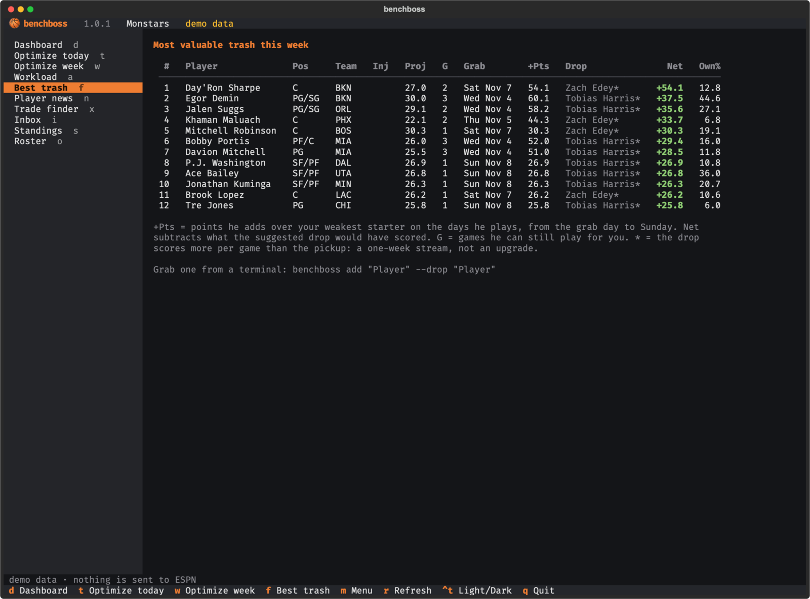<br><sub><b>Best trash</b>: points added this week, the days he plays, who to drop.</sub></td>
</tr>
<tr>
<td width="50%">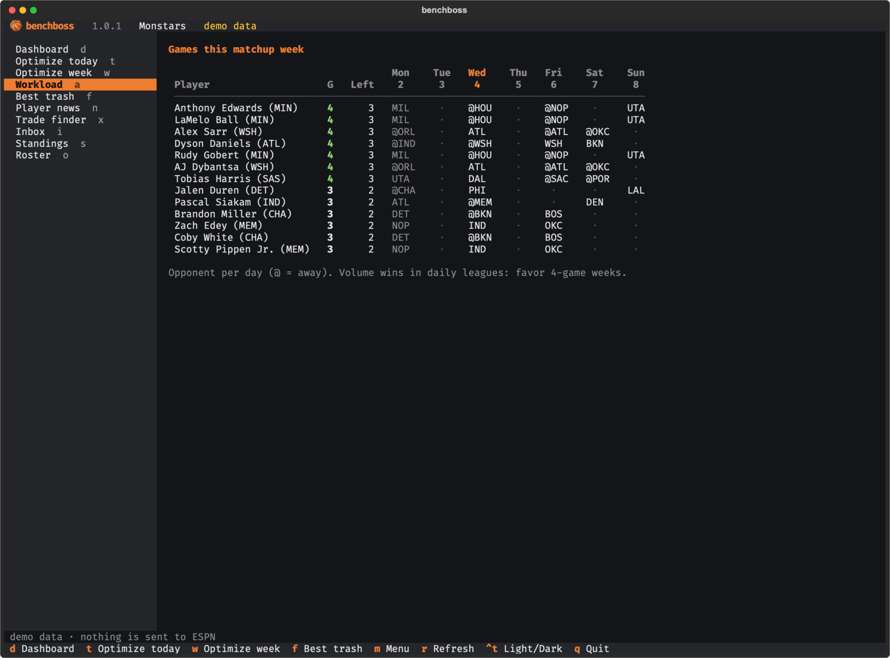<br><sub><b>Workload</b>: games per player this week, and the ones stuck on your bench.</sub></td>
<td width="50%">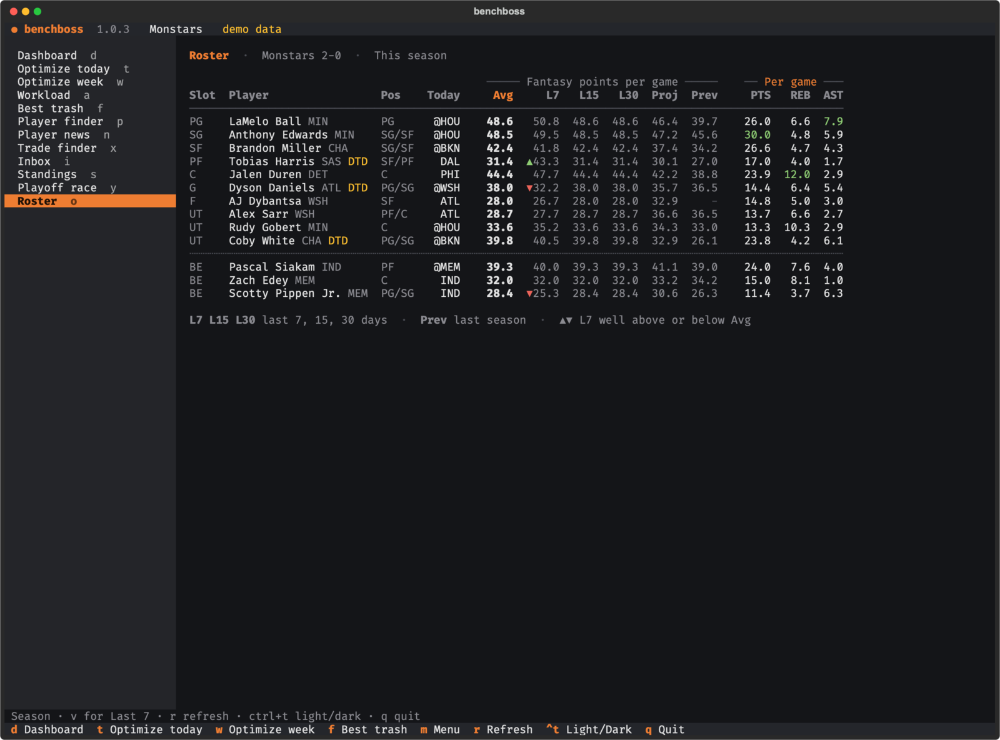<br><sub><b>Roster</b>: season, last 7, 15 and 30 days, projection and last season.</sub></td>
</tr>
<tr>
<td width="50%">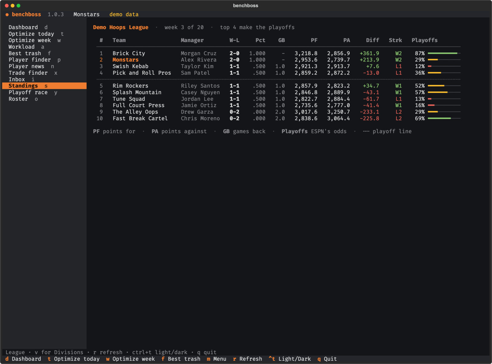<br><sub><b>Standings</b>: PF, PA, Diff, streaks and ESPN's playoff odds.</sub></td>
<td width="50%">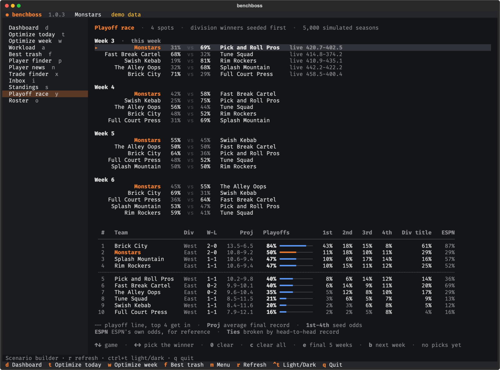<br><sub><b>Playoff race</b>: pick winners for the weeks left and see the odds move.</sub></td>
</tr>
<tr>
<td width="50%">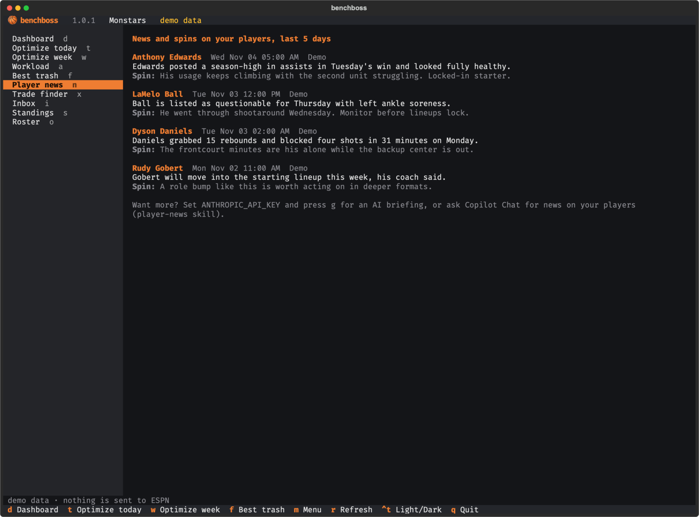<br><sub><b>Player news</b>: your roster and your watch list.</sub></td>
<td width="50%">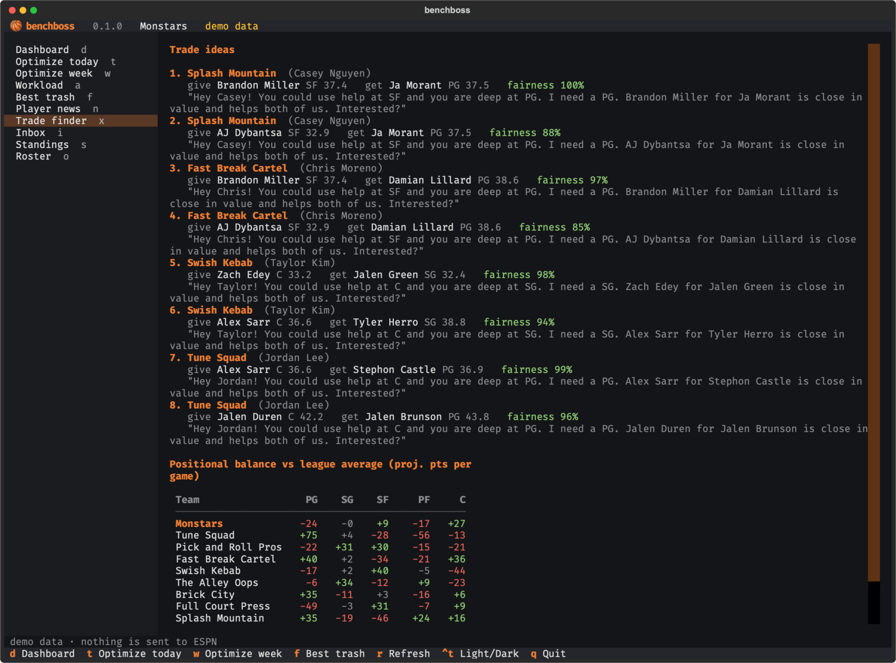<br><sub><b>Trade finder</b>: fair 1-for-1 deals that fix needs on both sides.</sub></td>
</tr>
</table>

## Install

**macOS and Linux, one line** (installs [uv](https://docs.astral.sh/uv/) if you do not have it, then benchboss):

```bash
curl -LsSf https://raw.githubusercontent.com/ValeQRamos/benchboss/main/install.sh | sh
```

**Already have uv or pipx?**

```bash
uv tool install "benchboss @ https://github.com/ValeQRamos/benchboss/archive/refs/heads/main.zip"
# or
pipx install https://github.com/ValeQRamos/benchboss/archive/refs/heads/main.zip
```

**Windows** (PowerShell):

```powershell
powershell -ExecutionPolicy ByPass -c "irm https://astral.sh/uv/install.ps1 | iex"
$env:Path = "$HOME\.local\bin;$env:Path"   # lets this window find uv; new windows find it on their own
uv tool install "benchboss @ https://github.com/ValeQRamos/benchboss/archive/refs/heads/main.zip"
```

None of these need git: they download the source as a zip file.

**From a clone** (for hacking on it):

```bash
git clone https://github.com/ValeQRamos/benchboss && cd benchboss
python3 -m venv .venv && source .venv/bin/activate
pip install -e ".[dev]"
```

Upgrade any time with `uv tool upgrade benchboss` (or `pipx upgrade benchboss`). Requires Python 3.10 or newer; uv downloads one for you if needed.

## Quick start

```bash
benchboss setup     # 1. connect your ESPN account, pick your league and team
benchboss           # 2. open the app
```

`setup` reads your ESPN session cookies (on macOS it can import them from Chrome; anywhere
else you paste them once), finds your basketball leagues automatically, and asks whether your
terminal background is dark or light. That is all.

<details>
<summary><b>Where do I find my ESPN cookies?</b></summary>

1. Sign in at [espn.com](https://www.espn.com) and open your fantasy league.
2. Open your browser's developer tools and find the cookies stored for `espn.com`
   (Chrome and Edge: **Application** tab, Firefox and Safari: **Storage** tab).
3. Copy the values of **`espn_s2`** (a long string) and **`SWID`** (looks like `{XXXXXXXX-...}`).
4. Paste them when `benchboss setup` or `benchboss login --manual` asks. Input is hidden.

They are stored in your operating system keychain and never leave your computer except in
requests to ESPN. Run `benchboss logout` to forget them.
</details>

Inside the app every screen has a single key:

| Key | Screen | Key | Screen |
|---|---|---|---|
| `d` | Dashboard | `n` | Player news |
| `t` | Optimize today | `x` | Trade finder |
| `w` | Optimize week | `i` | Inbox |
| `a` | Workload | `s` | Standings |
| `f` | Best trash | `y` | Playoff race |
| `p` | Player finder | `o` | Roster |
| `v` | Next view of this screen (roster split, standings table, workload order) | `r` | Refresh |
| `m` | Show or hide the menu (it hides itself below 110 columns) | `ctrl+t` | Light or dark |
| `g` | AI news briefing (needs `ANTHROPIC_API_KEY`) | `q` | Quit |

The Player finder has its own keys. Letters it does not use (`d`, `s`, `o`...) still jump
to the other screens, except while you type in the search box.

| Key | In the Player finder |
|---|---|
| `1` `2` `3` `4` | Free agents, players on a team, your watch list, everyone |
| `[` `]` | Previous or next position |
| `v` | Next stat split: Season, L7, L15, L30, Proj, Prev |
| `<` `>` | Sort by the column to the left or right (or click a header; click it again to flip the order) |
| `/` | Search by name, Enter to run it |
| `enter` | Open or close the player card: every split, ownership, news |
| `esc` | Leave the search box, close the card, or clear the search |
| `space` or `*` | Add the player to your ESPN watch list, or take him off. This one is sent right away, see [Privacy and safety](#privacy-and-safety) |

The Playoff race screen is a scenario builder: the games left on one side, the odds on the
other. Every pick runs the season again and a +/- column shows what your picks changed.

| Key | In the Playoff race |
|---|---|
| `↑` `↓` (or `k` `j`) | Previous or next game |
| `Page Up` `Page Down` | Previous or next week |
| `←` `→` (or `h` `l`) | The team on the left (home) or on the right (away) wins. The same key again clears it |
| `0` or `backspace` | Clear this game |
| `c` | Clear every pick |
| `e` | Jump to the final 5 weeks |
| `b` | Back to the next week |

## Using it from VS Code

benchboss was built to live in the VS Code integrated terminal.

- **Open the app:** in the terminal panel, run `benchboss`.
- **Side panel:** split the terminal and run `benchboss dash --watch` in the narrow half. It
  redraws every 60 seconds and adapts to the width.

  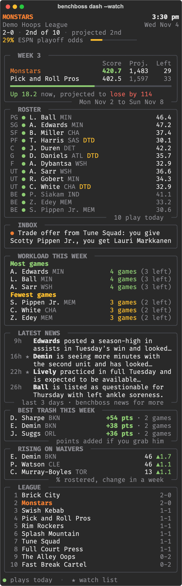

- **Tasks:** clone this repo and open the folder; `Tasks: Run Task` lists ready-made tasks
  (*benchboss: app*, *dashboard*, *optimize today*, *optimize week*, *best trash*, *news*).
- **GitHub Copilot (agent mode):** this repo ships [`AGENTS.md`](AGENTS.md),
  [`.github/copilot-instructions.md`](.github/copilot-instructions.md) and skills in
  [`.github/skills`](.github/skills). Open the folder, pick a model (Claude Sonnet works great)
  and ask in plain words: *"set my lineup for the rest of the week"*, *"who should I pick up?"*,
  *"news on my players from the last 5 days"*, *"find me a trade for a center"*, *"which free
  agent centers are hot over the last 7 days?"*, *"what are my playoff odds if I win this
  week?"*. The agent runs benchboss with `--json`, explains the result, and only writes to
  ESPN after you say yes.
- **Light theme?** Run `benchboss setup` again and choose light, or press `ctrl+t` in the app.

More in [docs/vscode.md](docs/vscode.md).

## Using it from a server or a phone

Run benchboss on a small always-on Linux server and open it over SSH from your Mac or your
phone, with `tmux` keeping the session alive, or serve it as a web page with
`benchboss web` behind a login. Setup, SSH keys, how users and cookies fit together and
troubleshooting are in [docs/server.md](docs/server.md).

## Commands

Run `benchboss --help` or `benchboss <command> --help` for every flag. Read commands accept
`--json`; write commands show what they will do and ask first (`--yes` skips the question).

| Command | What it does |
|---|---|
| `benchboss` | Interactive app (menu + screens) |
| `benchboss dash [--watch]` | Dashboard once, or live in a side terminal |
| `benchboss matchup` | Live score, projected final, games left |
| `benchboss roster [--view l7]` | Roster with every stat split, the box score of one (`season`, `l7`, `l15`, `l30`, `proj`, `last`), who plays today |
| `benchboss activity [--view games]` | Games per player this matchup week, day by day, with the bench marked (`lineup` order, or `games`: most games first) |
| `benchboss standings [--view divisions]` | League table with PA, Diff, streaks and playoff odds (`league`, `divisions`, `moves`) |
| `benchboss playoffs [--pick "Winner>Loser"] [--view games]` | Playoff odds. `--pick` fixes a result (add `@WEEK` for a given week, repeat for more); `--view games` lists the matchups left |
| `benchboss optimize [today\|tomorrow\|week\|11-04]` | Best lineup for a day or the rest of the week (`--dry-run` to only look) |
| `benchboss trash [POS] [-n N]` | Most valuable free agents for this week |
| `benchboss players [NAME] [--from fa\|rostered\|watch\|all] [--pos C] [--sort l7]` | Player finder: every split and the box score (`--view` picks the split for the box score) |
| `benchboss watch [list\|add\|remove] [PLAYER]` | Your ESPN watch list; `add` and `remove` ask first (`--dry-run` to only look) |
| `benchboss fa [POS]` · `benchboss trending` | Free agents by % rostered, or rising the fastest |
| `benchboss news [PLAYER ...] [--watch] [--days 5] [--ai]` | News and spins for your roster, your watch list or named players |
| `benchboss trades [--need C] [--with TEAM] [--needs]` | Trade ideas, or every team's positional balance |
| `benchboss alerts [--mark-read]` | Trade offers, accepted trades, pending claims, unread DMs, new watch-list news (`--mark-read` stops showing the news you saw) |
| `benchboss add PLAYER [--drop PLAYER]` · `drop` | Sign a free agent or put in a claim; release a player |
| `benchboss trade --give A --get B [--msg TEXT]` | Send a trade offer |
| `benchboss chat [TEXT] [--to TEAM]` | Read or post in the league chat or a DM |
| `benchboss setup` · `login` · `logout` · `status` | Account and configuration |

Full reference: [docs/commands.md](docs/commands.md).

## How the numbers work

- **Projections** come from ESPN (season projection per game, already scored with your
  league's settings). Before a player has a projection, his average is used. Day-to-day and
  questionable players count 75%, doubtful 25%, out and suspended 0.
- **Lineups** are solved exactly for each day: every possible assignment of players to your
  league's slots (positions, G, F, UT) is considered with a dynamic program, and ties keep
  players where they are so a day that is already right stays untouched. Future days are sent
  as ESPN "future roster" moves and re-checked right before sending.
- **Projected final** = points so far + for each remaining day, the best starters with a game.
- **Best trash**: for each free agent and each possible pickup day, his expected points count
  only on days he plays *and* beats the weakest starter you would otherwise use (or fills an
  open slot). Net value subtracts what the suggested drop would have scored over the same days.
  Waiver players start counting after their waiver period.
- **Trade finder** compares each team's projected points at PG, SG, SF, PF and C with the
  league average. A suggestion trades from your surplus into their need and back, at similar
  value (85% match by default), without breaking position limits.
- **Playoff race** plays the rest of the regular season 5,000 times. Each team's weekly score
  is drawn around what it is expected to score (results so far blended with its roster's
  projection, today's injuries only for this week and the next), with a 12% spread. Seeds
  follow ESPN's rules: division winners first, then the league's tiebreaker. ESPN's own odds
  sit next to ours for comparison.
- **Workload** reads the lineup ESPN has saved for each day of the week. A game counts for you
  only when the player is in a starting slot that day, so the games he spends on your bench
  are marked and left out of the `In` count.

Details and the API behind them: [docs/how-it-works.md](docs/how-it-works.md) and the
[ESPN Fantasy Basketball API reference](docs/api/README.md) we wrote along the way.

## Configuration

| Setting | Where | Notes |
|---|---|---|
| League, team, season, theme | `~/.config/benchboss/config.json` (Windows: `%APPDATA%\benchboss`) | Written by `benchboss setup` |
| ESPN cookies | OS keychain (service `benchboss`) | Fallback: `credentials.json` with 0600 permissions |
| `BENCHBOSS_LEAGUE_ID`, `BENCHBOSS_TEAM_ID`, `BENCHBOSS_SEASON`, `BENCHBOSS_THEME` | Environment | Override the config file |
| `ESPN_S2`, `ESPN_SWID` | Environment | Cookies for CI or containers |
| Watch-list news you have seen | `seen-news.json` next to `config.json` | Written when the app shows the news and by `benchboss alerts --mark-read` |
| `ANTHROPIC_API_KEY` | Environment | Enables `benchboss news --ai` |
| `BENCHBOSS_HOME` | Environment | Use a different config folder |

More in [docs/configuration.md](docs/configuration.md).

## Privacy and safety

- Your cookies stay on your machine (keychain) and are only sent to ESPN. benchboss never
  prints them, logs them or puts them in `--json` output.
- Nothing changes in your league without a confirmation: every write shows the exact moves and
  asks first. `--dry-run` shows the plan and sends nothing. Demo mode sends nothing to ESPN and
  saves nothing on your computer.
- One exception. In the app's Player finder, space adds a player to your ESPN watch list (or
  takes him off) right away, like the star in the ESPN app. Nobody else in the league sees your
  watch list and the same key undoes it. From the command line, `benchboss watch add|remove`
  asks first like every other write.
- What stays on your computer: your config, the cookies (in the keychain), and two small files
  with the watch-list news you have already seen (`seen-news.json`) and the ones the app already
  popped up (`toasted-news.json`). Nothing in them leaves your machine.
- Player news comes from ESPN's public feed and needs no cookies. The optional AI briefing sends
  only your players' names, NBA teams and positions to the Anthropic API, and only when you ask for it.
- benchboss is not affiliated with, endorsed by or supported by ESPN. It uses the same
  undocumented endpoints as ESPN's website, which can change without notice.

See [SECURITY.md](SECURITY.md) to report a vulnerability.

## FAQ

<details><summary><b>Does it work for category (roto, H2H categories) leagues?</b></summary>
The dashboard, roster, news, standings and lineup tools work, but projections and the trash
and trade math are built for points leagues. Categories support is on the roadmap.
</details>

<details><summary><b>Can it use another sport?</b></summary>
Not today. The ESPN API is similar across sports, so football and hockey are possible later.
</details>

<details><summary><b>`benchboss` says my cookies expired.</b></summary>
ESPN sessions eventually expire, for example when you sign out of espn.com. Run `benchboss login` again.
</details>

<details><summary><b>The colors look washed out or the boxes are broken.</b></summary>
Use a terminal with true color (VS Code, iTerm2, Ghostty, WezTerm, Kitty, Windows Terminal).
macOS Terminal.app only has 256 colors. On a light background run `benchboss setup` and
choose light, or pass `--theme light`.
</details>

<details><summary><b>Why are the playoff odds different from ESPN's?</b></summary>
ESPN does not say how it simulates the season. benchboss runs its own simulation from the
results so far and every roster's projection, and shows ESPN's number next to it. Early in the
season the two can be far apart. The model is in [docs/how-it-works.md](docs/how-it-works.md#playoff-race).
</details>

<details><summary><b>Why "trash"?</b></summary>
In our league free agents are lovingly called trash. Some trash is gold.
</details>

## Roadmap

- [ ] Categories leagues (projections per category, punt strategies)
- [ ] Per-game projections from ESPN once the season starts (finer daily numbers)
- [ ] Desktop notifications for trade offers and late scratches before lock
- [ ] Accept, decline and counter trades from the app
- [ ] Waiver claim editing and FAAB suggestions
- [ ] PyPI and Homebrew releases

## Contributing

Bug reports, ideas and pull requests are welcome. Start with [CONTRIBUTING.md](CONTRIBUTING.md):
it explains the layout, the demo dataset (so you can work without an ESPN league) and how to
run the tests.

## Contact

Suggestions, bug reports or just a good trade story: **[k1lldeer@proton.me](mailto:k1lldeer@proton.me)**

<sub>MIT licensed. Not affiliated with ESPN. NBA team and player names belong to their owners.</sub>
