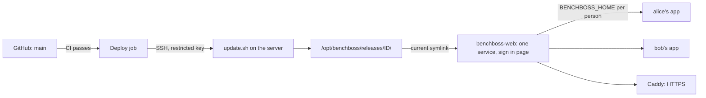

# Deploying benchboss

This page is the runbook for putting benchboss on a server and keeping it up to date: the
first deploy, updates, rollbacks, adding people, and an automatic deploy from GitHub.
[server.md](server.md) explains the pieces (SSH keys, cookies, the sign in page); this page is
the order to do things in.

Everything below was run against a real 512 MB Ubuntu 24.04 server. Nothing here is needed to
use benchboss on your own computer.

## How it fits together



| Piece | What it is |
|---|---|
| `/opt/benchboss/releases/<id>/` | One Python environment per version. Each deploy builds a new one. Four are kept. |
| `/opt/benchboss/current` | A symlink to the live release. Switching versions, and going back, is changing this link. |
| `/opt/benchboss/update.sh` | Builds a release, switches, health-checks the web service and **rolls back by itself** if it does not answer. |
| `benchboss-web` | The one web service for everyone. It runs as the `benchboss` system user and shows the sign in page. |
| `/var/lib/benchboss/` | `accounts.db` (names, password hashes, GitHub logins) and `users/NAME/`, one private folder per person with their ESPN cookies, settings and logs. |
| `/etc/benchboss/web.env` | The port, the public address and the GitHub sign in's id and secret. Readable only by root. |
| `benchboss-users` | Adds, lists and removes people. |

Each browser tab starts its own app process, with that person's folder as `BENCHBOSS_HOME`.
The server's own secrets and any `ESPN_S2` or `ESPN_SWID` in its environment are removed from
that process, and the system keychain is not used, so two people never share a login.

## First deploy

You need a server (section 1 to 3 of [server.md](server.md): create it, add your SSH key,
paste the provisioning script) and a name that points at it. Replace `SERVER_IP` and
`NAME` below. A free name that always works is the IP with dashes, for example
`203-0-113-7.sslip.io` for `203.0.113.7`.

**1. Check you can log in.**

```bash
ssh -i ~/.ssh/benchboss_ssh bb@SERVER_IP 'echo ok'
```

**2. Prepare the server.** From a clone of this repository on your computer:

```bash
export SSH_OPTS="-i $HOME/.ssh/benchboss_ssh"
deploy/deploy.sh bootstrap bb@SERVER_IP https://SERVER-IP-WITH-DASHES.sslip.io
```

The last argument is the address people will type. This installs `uv`, the release folder, the
`benchboss-users` tool and the `benchboss-web` service, creates the `benchboss` system user,
writes `/etc/benchboss/web.env`, and adds a 1 GB swap file on small servers. It is safe to run
again.

**3. Deploy a version.**

```bash
deploy/deploy.sh update bb@SERVER_IP
```

With no version it deploys the commit you are on. If that commit is on GitHub the server
downloads it from there; if not, your local copy is sent instead. This also starts the web
service. Check it:

```bash
deploy/deploy.sh status bb@SERVER_IP
ssh -i ~/.ssh/benchboss_ssh bb@SERVER_IP 'benchboss --version'
```

**4. Add the first person** (yourself). On the server:

```bash
sudo benchboss-users add bb
```

It prints a password **once**. Copy it into your password manager. To choose the password
yourself, put it in a file readable only by you and add `--password-file FILE`.

**5. Put HTTPS in front.**

```bash
sudo apt-get install -y caddy
sudo ufw allow 80/tcp && sudo ufw allow 443/tcp
sudo nano /etc/caddy/Caddyfile      # the address, then reverse_proxy 127.0.0.1:8000
sudo systemctl reload caddy
```

The block is the same for everyone, see [Caddyfile.example](../deploy/Caddyfile.example):

```
SERVER-IP-WITH-DASHES.sslip.io {
    reverse_proxy 127.0.0.1:8000
}
```

**6. Give the server your ESPN cookies.** Skip this: the first time you sign in on the web
page, a setup screen asks for the two cookies (`espn_s2` and `SWID`), then your league and
team. They are saved in your own folder on the server.

**7. Check it from outside.** From your computer, not the server:

```bash
curl -s -o /dev/null -w '%{http_code}\n' https://YOUR-NAME/login           # 200
curl -s -o /dev/null -w '%{http_code}\n' https://YOUR-NAME/ws              # 401: no session, no app
curl -s -m 5 -o /dev/null -w '%{http_code}\n' http://SERVER_IP:8000/       # 000: the raw port is closed
```

Then open `https://YOUR-NAME` in a browser and sign in with the name and password from step 4.

## Updating and rolling back

```bash
deploy/deploy.sh update bb@SERVER_IP            # the commit you are on
deploy/deploy.sh update bb@SERVER_IP v1.2.0     # a tag, a branch or a full commit sha on GitHub
deploy/deploy.sh update bb@SERVER_IP --local    # always send your local copy
deploy/deploy.sh status bb@SERVER_IP            # the live release and the ones kept
deploy/deploy.sh rollback bb@SERVER_IP          # go back one release (a few seconds)
```

What an update does:

1. Downloads the source and builds it into a new folder. Nothing live changes yet. If the build
   or `benchboss --version` fails, the update stops here.
2. Points `current` at the new release and restarts the web service.
3. Asks the sign in page for an answer for up to 40 seconds.
4. If it does not answer, it points `current` back, restarts, and moves the broken release
   to `/opt/benchboss/failed/` for you to look at. The update exits with an error.

Expect the app to be unreachable for a few seconds during a restart, and for about 40 extra
seconds when a release fails and is rolled back. Browser sessions in progress end, and people
sign in again only if their 12 hours ran out.

To see why a release failed:

```bash
ls /opt/benchboss/failed/
sudo journalctl -u benchboss-web --since '10 minutes ago' --no-pager | tail -40
```

## Adding people

One person is one row in the accounts file and one private folder under
`/var/lib/benchboss/users/`. They all use the same address and the same installed version.
There is nothing to add to Caddy, no port and no extra service.

```bash
sudo benchboss-users add alice
```

It prints a random password **once**. Then:

1. Give the person three things: the address, the name `alice` and the password. Send the
   password over a private channel, not a shared chat. (The name is lowercase letters and
   digits, 2 to 16, starting with a letter.)
2. They sign in. Because they have no cookies yet, a setup screen asks for their `espn_s2` and
   `SWID`, then their league and team.

Other things you can do:

```bash
sudo benchboss-users list                      # everyone, their GitHub login and whether they have cookies
sudo benchboss-users password alice            # a new password; their open sign ins end at once
sudo benchboss-users remove alice --yes        # delete the account and ALL their data
sudo benchboss-users add bob --password-file FILE   # choose the password yourself
```

Removing a person or changing their password signs them out on their next click, even if their
12 hours have not passed.

**Sign in with GitHub.** One GitHub OAuth app serves everyone. Register it on GitHub (Settings,
Developer settings, OAuth Apps, New) with the server's address as homepage and
`https://YOUR-ADDRESS/login/github/callback` as callback URL. Then:

```bash
sudo benchboss-users oauth --client-id THE_CLIENT_ID     # asks for the secret, hidden
sudo benchboss-users github alice alicelogin             # alicelogin signs in as alice
sudo benchboss-users github alice                        # unlink
```

Only a GitHub login you linked to someone can sign in, and it acts as that person's ESPN
account, so link only people who should have it.

**Moving an older install in** (one Linux user per person, from before this layout). See
[Moving from one app per person](#moving-from-one-app-per-person).

**Terminal access for a person** (optional, not needed for the web page): that is an SSH login
on the server, separate from the web accounts. Add their SSH public key to a Linux user of
their own, without `sudo`.

**Your own devices** (a new phone or laptop for the admin user `bb`): add its public key to
`/home/bb/.ssh/authorized_keys`. To remove a device, delete its line.

**How many people fit.** Accounts are cheap: a row each. What costs memory is open browser tabs.
Every open tab runs its own app process of about 70 MB, and the whole service is capped at
420 MB. The default `BB_ARGS` in `/etc/benchboss/web.env` lets 5 tabs be open at once and 2 per
person (`--max-sessions 5 --max-per-user 2`); a tab over the limit is refused with a short
message and works again when another closes. A 512 MB server suits a few friends who are not
all online at once. For more, use a 1 GB server and raise the numbers, then
`sudo systemctl restart benchboss-web`. Look at `free -m` and
`sudo systemctl status benchboss-web` before blaming the network.

### Moving from one app per person

Before this layout each person was a Linux user running `benchboss-web@NAME` on their own port
with their own Caddy block. To move over, once, on the server (after `deploy/deploy.sh
bootstrap` and `update` with the new version):

```bash
for n in bb vale; do                       # the names of the existing Linux users
  sudo systemctl disable --now benchboss-web@$n
  sudo benchboss-users import $n \
    --from /home/$n/.config/benchboss --password-file /home/$n/.bb-web-password
done
sudo systemctl enable --now benchboss-web
sudo nano /etc/caddy/Caddyfile      # one block, reverse_proxy 127.0.0.1:8000; remove the others
sudo systemctl reload caddy
```

`import` copies their cookies, league settings, auto-swap marks and logs, and keeps their
existing sign in password (the old user name `owner` is replaced by their own name). Check that
it works, then remove the old files:

```bash
sudo rm /etc/benchboss/bb.env /etc/benchboss/vale.env
sudo rm /etc/systemd/system/benchboss-web@.service && sudo systemctl daemon-reload
rm /home/bb/.bb-web-password           # and the same for each person
```

## Automatic deploys from GitHub

The repository has two workflows:

- **CI** ([ci.yml](../.github/workflows/ci.yml)) runs lint and tests on every push to `main`
  and on pull requests, on Linux, macOS and Windows.
- **Deploy** ([deploy.yml](../.github/workflows/deploy.yml)) runs when CI **passes on a push to
  `main`**, and installs that exact commit on the server. It also has a manual button.

The deploy job only ever runs one command on the server: `update.sh` with a full commit sha, a
version tag, or the words `rollback` and `status`. That is enforced on the server, not just in
the workflow (next section), so a leaked deploy key cannot open a shell.

It never runs for a pull request, including one from a fork, and two deploys never run at the
same time. After deploying it requests your sign in page from GitHub's servers and fails if it
does not answer.

### One-time setup

**1. Make a deploy key that can do one thing.** On your computer:

```bash
ssh-keygen -t ed25519 -N '' -C benchboss-ci -f ./ci-key
```

(No passphrase: it is used by a machine, and the restriction below is what protects it.)

**2. Allow it on the server, restricted to the updater.**

```bash
echo "command=\"/opt/benchboss/update.sh\",restrict $(cut -d' ' -f1,2 ci-key.pub) benchboss-ci" \
  | ssh -i ~/.ssh/benchboss_ssh bb@SERVER_IP 'cat >> ~/.ssh/authorized_keys'
```

`command=` makes every login with this key run the updater and nothing else, whatever the
client asks for. `restrict` turns off shells, port forwarding and the rest. Test it:

```bash
ssh -i ./ci-key -o IdentitiesOnly=yes bb@SERVER_IP status      # shows the releases
ssh -i ./ci-key -o IdentitiesOnly=yes bb@SERVER_IP 'ls /'      # refused
```

**3. Note the server's identity,** so GitHub cannot be tricked into deploying to another
machine:

```bash
ssh-keyscan -t ed25519 SERVER_IP 2>/dev/null                    # this line is DEPLOY_KNOWN_HOSTS
ssh -i ~/.ssh/benchboss_ssh bb@SERVER_IP 'ssh-keygen -lf /etc/ssh/ssh_host_ed25519_key.pub'
ssh-keyscan -t ed25519 SERVER_IP 2>/dev/null | ssh-keygen -lf -   # the two fingerprints must match
```

**4. Create the `production` environment on GitHub.** Repository, Settings, Environments, New
environment, named `production`. Under it:

- Deployment branches: only `main`.
- Required reviewers: add yourself if you want to approve each deploy (optional).
- Secrets: `DEPLOY_SSH_KEY` is the whole content of the `ci-key` file (`pbcopy < ci-key`), and
  `DEPLOY_KNOWN_HOSTS` is the line from step 3.
- Variables: `DEPLOY_HOST` is `bb@SERVER_IP`, and `DEPLOY_URL` is the public address, for
  example `https://203-0-113-7.sslip.io`.

**5. Delete the local copy of the key** and clear the clipboard:

```bash
rm ci-key ci-key.pub && pbcopy < /dev/null
```

**6. Merge to `main`.** GitHub runs a `workflow_run` workflow only from the default branch, so
the Deploy workflow starts working once it is on `main`.

### Using it

- **Normal flow:** merge to `main`. CI runs, then Deploy installs that commit. Watch it under
  the Actions tab.
- **Deploy a tag or an older commit:** Actions, Deploy, Run workflow, action `deploy`, and the
  full sha or tag in `ref`.
- **Roll back:** Actions, Deploy, Run workflow, action `rollback`. Or from your computer:
  `deploy/deploy.sh rollback bb@SERVER_IP`.
- **Turn automatic deploys off:** disable the Deploy workflow in the Actions tab. Manual
  `deploy/deploy.sh` still works.

### Keeping it simple on purpose

There is no staging server, no build artifact store and no database migration step. The server
downloads the commit from GitHub and builds it, which takes under a minute on a small server.
If you later want a staging copy, add a second server and a second environment with its own
secrets, and let the workflow deploy to it first. If the repository becomes private, the server
needs a read token to download (set `BENCHBOSS_REPO` and teach `update.sh` to send it), or the
workflow can send the source itself with `git archive`, like `deploy.sh --local` does.

## Troubleshooting

| Symptom | Likely cause and fix |
|---|---|
| `update: uv is not installed` | The server was not bootstrapped. Run `deploy/deploy.sh bootstrap`. |
| `update: that does not look like benchboss` | The download was empty or the ref does not exist on GitHub. A branch or commit that is only on your computer needs `--local`. |
| Update ends with `failed its check` | The new version did not start. Look in `/opt/benchboss/failed/` and the journal (above). The site stayed on the old version. |
| Caddy shows 502 | The web app behind it is down or restarting: `sudo systemctl status benchboss-web` and `sudo journalctl -u benchboss-web -n 50`. |
| The server stops answering SSH and the page | Out of memory. Power cycle from the provider's panel, then check `free -m`. Add swap (bootstrap does) or use a bigger server, and lower `--max-sessions` in `/etc/benchboss/web.env`. |
| A tab does not open and the browser says the connection closed | The server is at its tab limit (`--max-sessions`, `--max-per-user`). Close another tab, or raise the limits if the server has the memory. |
| `no accounts yet` in the journal, and nobody can sign in | Run `sudo benchboss-users add NAME`. |
| Deploy job: `Permission denied (publickey)` | The key secret is incomplete (include the `BEGIN` and `END` lines) or the `authorized_keys` line has a typo. Test it by hand as in step 2. |
| Deploy job: `Host key verification failed` | `DEPLOY_KNOWN_HOSTS` does not match the server (for example after rebuilding it). Redo step 3. |
| Deploy job never starts after a merge | The Deploy file is not on `main` yet, or CI failed, or the environment waits for your approval. |
