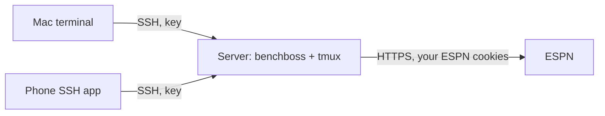
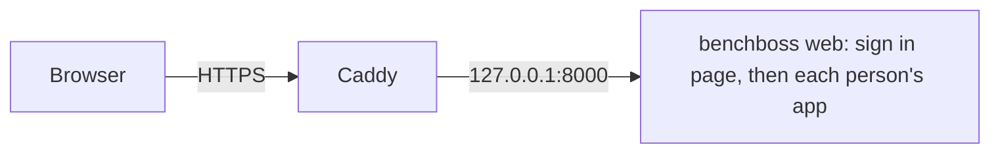

# Running benchboss on a server

This page shows how to run benchboss on a small cloud server (a "droplet" or VPS) and use it
from your Mac or your phone over SSH. The server stays on, so `tmux` keeps your session alive
and later features (alerts, scheduled tasks) can run when your own computer is off.

Nothing here is required. benchboss works fine on your own machine.

This page explains the pieces. The order to do things in, updating, rolling back, adding people
and automatic deploys from GitHub are in [deploy.md](deploy.md).



## What lives where

| Piece | Where |
|---|---|
| benchboss itself | `/opt/benchboss/releases/<id>/`, the live one linked as `/opt/benchboss/current` (see [deploy.md](deploy.md)) |
| Each person's settings (`~/.config/benchboss/`) | the server, in that person's own Linux user home |
| ESPN cookies (`espn_s2`, `SWID`) | the server, in `credentials.json` (permissions `0600`) |
| SSH private keys | each device that logs in (Mac, phone). They never leave the device. |
| SSH public keys | the server, in `~/.ssh/authorized_keys` |

## Who is who: users, keys and cookies

benchboss has no accounts of its own. Three separate things identify "you":

1. **The SSH key** decides who may log in to the server. One key per device, so you can remove
   one device without touching the others.
2. **The Linux user** (for example `bb`) owns the benchboss settings. Whoever logs in as that
   user runs benchboss as that ESPN account. If two people share a server, give each their own
   Linux user, and each runs `benchboss setup` in their own home. `BENCHBOSS_HOME` can point
   one user at several settings folders (one per league).
3. **The ESPN cookies and the league settings** decide which ESPN account and team benchboss
   acts as. The cookies alone are not enough. benchboss also needs the league id and your team
   id, which `benchboss setup` saves in `config.json`. Both cookies are required: `SWID` is
   your ESPN member id, and `espn_s2` is the session secret. Before any write, benchboss
   checks that your `SWID` is an owner of the configured team, and refuses otherwise.

So the cookies are the credential for ESPN, the SSH key is the credential for the server, and
`config.json` says which league and team to use. Treat the cookies like a password: they can
change your lineup and make trades.

## 1. Create the server

Any small Linux server is enough (512 MB to 1 GB of memory). These notes use Ubuntu 24.04 LTS
and a provider that offers a "user data" or "startup script" box when you create the server
(DigitalOcean, Hetzner and others do).

- Choose a region close to you.
- Add your SSH public key in the creation form (see the next section).
- Paste the provisioning script from section 3 into the user data box.

## 2. Make an SSH key

Use an Ed25519 key, one per device.

```bash
ssh-keygen -t ed25519 -C "benchboss-server" -f ~/.ssh/benchboss_ssh
```

- `~/.ssh/benchboss_ssh` is the **private** key. Never share it, commit it or paste it into
  chat or tickets. Keep it outside any git repository.
- `~/.ssh/benchboss_ssh.pub` is the **public** key (one line starting with `ssh-ed25519`).
  This is the part you give to the server.
- Add a passphrase when `ssh-keygen` asks. Without one, anyone who gets the key file can log
  in, and the server holds your ESPN cookies.

To compare a key you see on the server with one on a device, compare fingerprints, not the
long text:

```bash
ssh-keygen -lf ~/.ssh/benchboss_ssh.pub          # on your device
ssh-keygen -lf ~/.ssh/authorized_keys            # on the server, one line per key
```

## 3. Provision the server

Paste this into the user data box. It runs once, as root, on first boot. Replace `PUBKEY` with
the contents of your `.pub` file. Do not put ESPN cookies or any other secret in it: user
data is stored by the provider and readable from the server.

```bash
#!/bin/bash
set -eu
exec > >(tee /var/log/benchboss-provision.log) 2>&1

USER_NAME=bb
PUBKEY="ssh-ed25519 AAAA...your-public-key... benchboss-server"

export DEBIAN_FRONTEND=noninteractive
apt-get update
apt-get install -y curl tmux mosh ufw unattended-upgrades

# A normal user with your key
id "$USER_NAME" >/dev/null 2>&1 || useradd -m -s /bin/bash "$USER_NAME"
install -d -m 700 -o "$USER_NAME" -g "$USER_NAME" "/home/$USER_NAME/.ssh"
echo "$PUBKEY" > "/home/$USER_NAME/.ssh/authorized_keys"
chown "$USER_NAME:$USER_NAME" "/home/$USER_NAME/.ssh/authorized_keys"
chmod 600 "/home/$USER_NAME/.ssh/authorized_keys"
echo "$USER_NAME ALL=(ALL) NOPASSWD:ALL" > "/etc/sudoers.d/90-$USER_NAME"
chmod 440 "/etc/sudoers.d/90-$USER_NAME"

# Keys only, no root login. The 00- prefix makes it win over cloud-init's 50-*.conf,
# because sshd uses the first value it sees.
cat > /etc/ssh/sshd_config.d/00-hardening.conf <<'EOF'
PermitRootLogin no
PasswordAuthentication no
KbdInteractiveAuthentication no
EOF
sshd -t && systemctl restart ssh

# Firewall: SSH and mosh only
ufw allow OpenSSH
ufw allow 60000:61000/udp
ufw --force enable

# Tailscale (download first, then run)
ts="$(mktemp)"
curl -fsSL https://tailscale.com/install.sh -o "$ts"
sh "$ts"
rm -f "$ts"

# benchboss itself is installed next, from your computer: deploy/deploy.sh (see deploy.md)

echo "provisioning done"
```

Notes on the script:

- The user has passwordless `sudo`. That is needed because there is no password, so your SSH
  key is the only protection. Use a passphrase.
- First boot takes a few minutes. `tail /var/log/benchboss-provision.log` on the server ends
  with `provisioning done` when it is finished.
- It does not install benchboss. Do that with `deploy/deploy.sh bootstrap` and `update`
  ([deploy.md](deploy.md)), which also adds swap on a small server.

## 4. Connect

Find the server's public IP address in the provider's panel and **copy it exactly**. Swapped
digits connect you to someone else's server, where login fails and nothing shows in your
server's log.

```bash
ssh -i ~/.ssh/benchboss_ssh bb@SERVER_IP
```

This works from any directory as long as the key path is absolute or starts with `~`. To skip
the `-i`, add this to `~/.ssh/config` and run `ssh bbserver`:

```
Host bbserver
    HostName SERVER_IP
    User bb
    IdentityFile ~/.ssh/benchboss_ssh
    IdentitiesOnly yes
```

Then join your Tailscale network, and (once it works from your devices) close public SSH:

```bash
sudo tailscale up                  # open the URL it prints and log in
sudo ufw delete allow OpenSSH      # only after you can reach the server over Tailscale
```

### From a phone

Use an SSH app (Termius, Blink Shell on iOS; Termius or Termux on Android).

1. **Generate a key in the app** (Ed25519). Do not copy your Mac's private key to the phone.
2. Copy the app's **public** key, and add it on the server. From a computer that can already
   log in:

   ```bash
   ssh -i ~/.ssh/benchboss_ssh bb@SERVER_IP 'cat >> ~/.ssh/authorized_keys'
   ```

   Paste the key, press Enter, then `Ctrl+D`. Pasting through stdin avoids quoting problems.
3. In the app, make a host: address `SERVER_IP`, port `22`, user `bb`, no password, and the key
   you generated.
4. Connect and run:

   ```bash
   tmux new -As bb benchboss
   ```

   Detach with `Ctrl+b` then `d`. Run the same command to come back to the same screen.

The app switches to one column below 92 columns, which suits a phone held upright. Try
`benchboss --demo` first: it uses fictional data and sends nothing to ESPN.

To remove a device, delete its line from `~/.ssh/authorized_keys` on the server.

## 5. Give the server your ESPN cookies

`benchboss login` reads cookies from a browser on the same computer, so it cannot import them on
a server. Send them from your Mac, over SSH, with one command (it reads Chrome, or the
cookies already saved on the Mac, and never prints them):

```bash
benchboss login --to bb@SERVER_IP --identity ~/.ssh/benchboss_ssh
```

It shows what it will do and asks first (add `--dry-run` to only look, `--yes` to skip the
question). The cookies travel on SSH's standard input, never in a command line, and land in
`~/.config/benchboss/credentials.json` on the server with `0600` permissions. macOS may ask
once for permission to read Chrome's cookies. Then, on the server:

```bash
benchboss setup          # finds the cookies, then asks for the league and your team
benchboss status --json  # "connected": true means ESPN accepted the server
```

Cookies expire now and then. When `benchboss` exits with code 3, repeat this step. If you
ever paste cookies somewhere by accident, sign out of ESPN everywhere to invalidate them.

## 6. Use it in a browser (optional)

Instead of SSH and `tmux`, the server can serve the app as a web page. You get a link you can
open from any browser, including a phone.



`benchboss web` has its own sign in page, in the style of the app, with a password and
optionally GitHub. It sits in front of everything the web app serves, including the
websocket, so the app never starts for someone who is not signed in. A reverse proxy (Caddy)
only adds HTTPS. Without `--accounts`, `--password-file` or the `--github-*` options there is
**no login at all**: anyone who reaches the page acts as the ESPN account on the server and can
press Apply. In that case put a proxy with a login in front. Either way `benchboss web` listens
on `127.0.0.1` only (it refuses any other `--host` unless you add `--allow-remote`).

There are two ways to run it:

- **One person** (`--password-file`, and optionally `--github-*`): one name, `owner`, and one
  ESPN account, the one on the machine.
- **Several people** (`--accounts`, what the server setup uses): a list of people in a small
  database, each with their own password and their own folder of settings and cookies. One
  address and one service for everyone. Manage them with `benchboss users` (on a server,
  `sudo benchboss-users`, see [deploy.md](deploy.md#adding-people)).

### Install and run

On a server, do not run `benchboss web` by hand. `deploy/deploy.sh` installs releases and the
service `benchboss-web` (the unit is
[deploy/benchboss-web.service](../deploy/benchboss-web.service)), which runs
`benchboss web --accounts`. The steps are in [deploy.md](deploy.md#first-deploy). To try it by
hand on your own computer:

```bash
pip install 'benchboss[web]'
benchboss --demo web          # the fictional league: nothing is sent to ESPN
```

Options you can set on the service live in `/etc/benchboss/web.env` (root only): `BB_PORT`,
`BB_URL` and `BB_ARGS` (extra `benchboss web` options, such as `--max-sessions 5`
`--max-per-user 2`).

### Several people (accounts)

With `--accounts`, each person has an account (name, password hash, optional GitHub login) in
`accounts.db` and a private folder `users/NAME` next to it, both under the service's
`BENCHBOSS_HOME`. When someone opens the page, their app starts with their own folder as
`BENCHBOSS_HOME`, so their cookies, league, auto-swap marks and logs are theirs alone. The
server's own secrets, any `ESPN_S2` and `ESPN_SWID` in its environment, and the system keychain
are kept out of that process.

Be clear about the limit of this design: every person's app runs as the same Linux user and is
separated by folders and file permissions, not by the operating system. It protects people from
each other's mistakes and from a stolen sign in, not from a bug that lets someone run code on
the server. Run it for people you know.

### Sign in with a password

In accounts mode, `benchboss users add NAME` makes a random password and prints it once. The
sign in page takes that name and password. With `--password-file` the user name is `owner` and
the file holds the password:

```bash
benchboss users password NAME     # accounts: make a new one (their open sign ins end)
```

By hand, a `--password-file` must not be readable by other users and the password needs 12
characters or more. What the sign in does:

- A signed session cookie (`HttpOnly`, `SameSite=Lax`, `Secure` when `--url` is `https`) that
  lasts 12 hours (`--session-hours`). Open `/logout` to end it. With accounts it also ends when
  the person is removed or their password changes.
- Five wrong passwords from one address lock it out for ten minutes, and every wrong try
  waits half a second. The page tells you nothing about which half was wrong.
- Passwords are stored as scrypt hashes, never as text.
- Forms and websockets from another site are refused.
- `--max-sessions` and `--max-per-user` cap the open tabs (about 70 MB each).
- The signing key is `web-secret` in the config folder, made on first use with `0600`
  permissions. Delete it and restart to sign everyone out.

### Sign in with GitHub

GitHub sign in lets in only GitHub users that you linked to a person (accounts mode) or listed
with `--github-users` (one person). It needs an OAuth app that you register once under GitHub,
Settings, Developer settings, OAuth Apps, New OAuth App:

- Homepage URL: your public address, for example `https://bb.example.com`.
- Authorization callback URL: `https://bb.example.com/login/github/callback`.

Copy the client id, generate a client secret and keep it out of the command line (anyone on
the server can read command lines). On the server, `benchboss-users` asks for the secret with
hidden input and stores it in `/etc/benchboss/web.env` (root only), then you link people:

```bash
sudo benchboss-users oauth --client-id YOUR_CLIENT_ID
sudo benchboss-users github NAME yourlogin
```

The login is a GitHub login or a numeric id. By hand, the secret goes in the
`BENCHBOSS_GITHUB_CLIENT_SECRET` environment variable (never an argument), the id in
`--github-client-id`, and with one person the allowed logins in `--github-users`.

The page then shows a Sign in with GitHub button. A GitHub account that nobody linked sees
"is not allowed here" and gets no session. `--url` is required, since GitHub sends the browser
back to that address.

### HTTPS in front

Use [Caddy](https://caddyserver.com). It gets and renews the certificate by itself. You need a
name that points at the server: your own domain, or a free name such as
`SERVER-IP-WITH-DASHES.sslip.io` (for `203.0.113.7`, `203-0-113-7.sslip.io`).

```bash
sudo apt-get install -y caddy
```

Copy [deploy/Caddyfile.example](../deploy/Caddyfile.example) to `/etc/caddy/Caddyfile`, set
your name (one block for everyone), then open ports 80 and 443 and reload:

```bash
sudo ufw allow 80/tcp && sudo ufw allow 443/tcp
sudo systemctl reload caddy
```

Never serve the app over plain `http://`: the password and the cookies would travel in the
clear.

### First run

In a browser session with no ESPN cookies or no league, the app opens a setup screen with two
hidden fields (`espn_s2` and `SWID`), then picks your league and team the same way
`benchboss setup` does. If you already sent the cookies with `login --to`, you only choose the
league and team. A terminal session never shows this screen and behaves as before.

## Known limits

- **News from a datacenter IP.** ESPN's player news host `site.api.espn.com` answered
  `403 Access Denied` from a cloud IP in testing. benchboss therefore asks
  `site.web.api.espn.com` first, which serves the same feed and answered from the same server,
  and falls back to `site.api.espn.com`. If both ever refuse a server, `benchboss alerts`
  prints `Watch list news is not available right now` and still shows trade offers, claims and
  messages.
- **Cookies live on the server.** Anyone with shell access to that Linux user can read them.
  Keep the server patched and the SSH key protected.

## Troubleshooting

| Symptom | Likely cause and fix |
|---|---|
| `Permission denied (publickey)` | The key the client offers is not in `authorized_keys`. Compare fingerprints (section 2). Log in as `bb`, not `root`. Use `-i` with the full path. |
| App says the private key is empty | The key was not imported or pasted. Re-add it and check that the preview shows the whole `BEGIN` to `END` block. |
| Nothing at all in the server log when you connect | The client is reaching a different machine. Check the IP digit by digit, then check the network (try cellular if Wi-Fi blocks port 22). |
| `Host key verification failed` after a rebuild | The server has a new host key. Remove the old entry with `ssh-keygen -R SERVER_IP`. |
| `benchboss: command not found` | No version is deployed yet. Run `deploy/deploy.sh update` ([deploy.md](deploy.md)). The command lives at `/usr/local/bin/benchboss`. |
| `benchboss` exits with code 3 | The cookies are missing or expired. Repeat section 5. |

To watch what the server sees while a device tries to log in:

```bash
sudo journalctl -u ssh -f --no-pager
```

To see which keys the server accepts, without printing them in full:

```bash
ssh-keygen -lf ~/.ssh/authorized_keys
sudo sshd -T | grep -Ei '^(passwordauthentication|kbdinteractiveauthentication|pubkeyauthentication|permitrootlogin)'
```

The second command should show `passwordauthentication no` and `permitrootlogin no`.

## Security checklist

- SSH keys only, root login off, firewall on, automatic security updates on.
- One SSH key per device, each with a passphrase.
- Private keys stay out of git, chat and cloud-synced folders.
- Reach SSH over Tailscale and close port 22 to the internet once that works.
- No cookies or keys in the provisioning script or in user data.
- If you use the web app: a sign in (`--password-file` or GitHub) and HTTPS in front of it,
  `benchboss web` on `127.0.0.1`, the app ports (8000 and up) closed to the internet, and a
  long random password.
- For automatic deploys: a deploy key that can only run the updater (`command="...",restrict`
  in `authorized_keys`), and the server's host key pinned in GitHub ([deploy.md](deploy.md)).
- Keep a spare way in (the provider's web console) in case you lock yourself out.
